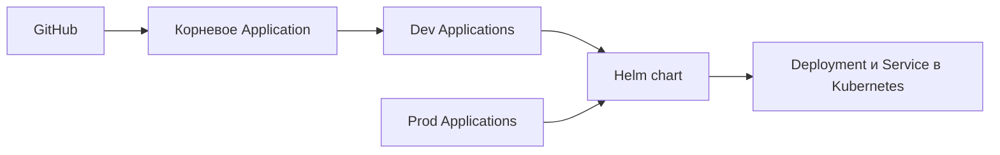

# GitOps-проект на Kubernetes

Учебный DevOps-проект: развёртывание приложений в Kubernetes через Argo CD и Helm. Для dev и prod используются отдельные Argo CD Applications, namespace и значения Helm.

## Архитектура



`root.yaml` следит за каталогом `demo_dev/applications`. Production Applications находятся в `demo_prod/applications` и регистрируются отдельно. Все приложения используют `HelmCharts/MyChart1`.

| Окружение | Файл values | Реплики | Образ |
| --- | --- | ---: | --- |
| Dev | `values_dev.yaml` | 4 | `nginx:alpine` |
| Prod | `values_prod.yaml` | 3 | `nginx:alpine` |

В чарте настроены HTTP readiness/liveness probes и ограничения CPU/памяти. Service по умолчанию имеет тип `ClusterIP`. Ingress можно включить отдельно, задав домен, класс контроллера и TLS.

## Структура

```text
.
├── root.yaml                    # Корневое Argo CD Application для dev
├── demo_dev/applications/       # Applications для dev
├── demo_prod/applications/      # Applications для prod
├── .github/workflows/           # Проверки Helm в GitHub Actions
└── HelmCharts/
    ├── MyChart1/                # Chart, используемый Applications
    └── MyChart2/                # Дополнительный пример chart
```

## Требования

- Kubernetes-кластер и `kubectl`
- Argo CD, установленный в кластере
- Helm 3
- SSH-доступ Argo CD к репозиторию `git@github.com:maxkerim/argocd2.git`

## Запуск

1. Добавьте SSH-ключ репозитория в Argo CD, если репозиторий закрытый.
2. Примените корневое Application для dev:

   ```sh
   kubectl apply -f root.yaml
   ```

3. Зарегистрируйте production Applications:

   ```sh
   kubectl apply -f demo_prod/applications/
   ```

4. Проверьте chart локально:

   ```sh
   helm lint HelmCharts/MyChart1
   helm lint HelmCharts/MyChart2
   helm template demo HelmCharts/MyChart1 -f HelmCharts/MyChart1/values_dev.yaml
   helm template demo HelmCharts/MyChart1 -f HelmCharts/MyChart1/values_prod.yaml
   ```

GitHub Actions автоматически запускает lint и проверяет рендеринг values при push и pull request.

## Как открыть приложение снаружи

`ClusterIP` доступен только внутри кластера. Для локальной проверки можно временно пробросить порт:

```sh
kubectl port-forward -n app1-prod svc/myapp1-prod-service 8080:80
```

После этого откройте `http://localhost:8080`.

В облачном кластере для внешнего IP можно изменить `service.type` в `HelmCharts/MyChart1/values.yaml` на `LoadBalancer` и отправить изменение в Git. Затем проверьте адрес:

```sh
kubectl get svc -n app1-prod
```

У этого способа обычно создаётся отдельный балансировщик для каждого Service, что может стоить денег. Для нескольких приложений обычно используют Ingress: один внешний балансировщик направляет запросы к разным сервисам по домену или URL-пути. В чарте Ingress доступен, но по умолчанию выключен.

### Настройка Ingress

Ingress требует установленного в кластере ingress-controller (например, NGINX Ingress Controller) и DNS-записи, указывающей на адрес этого контроллера. Чтобы включить его для production, настройте `HelmCharts/MyChart1/values_prod.yaml`:

```yaml
ingress:
   enabled: true
   className: nginx
   hosts:
      - host: app.example.com
         paths:
            - path: /
               pathType: Prefix
   tls:
      - secretName: app-tls
         hosts:
            - app.example.com
```

Замените `app.example.com` на свой домен, создайте DNS-запись на адрес ingress-controller и создайте TLS Secret `app-tls` в namespace приложения. Если TLS пока не нужен, задайте `tls: []` или удалите блок. Argo CD применит Ingress вместе с остальными ресурсами после отправки изменений в Git.

Также поддерживается `NodePort`, но он открывает порт на узлах кластера и обычно требует дополнительной настройки сети и firewall.

## Проверки и следующие шаги

- GitOps-доставка с автоматической синхронизацией, prune и self-heal.
- Разделение dev/prod по namespace и параметрам Helm.
- Проверки Helm chart в CI.
- Добавить тест валидации Kubernetes-манифестов.
- Добавить скриншоты статуса Argo CD после реального развёртывания.